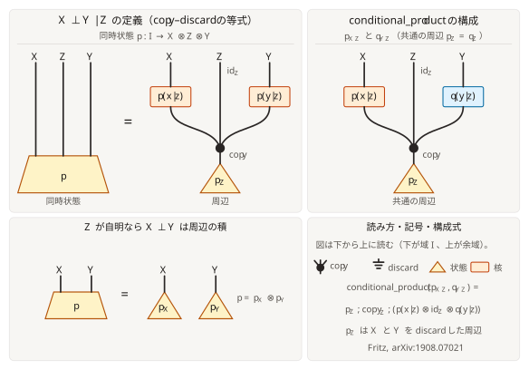

Conditional independence
========================

:meth:`~fxtensor_salmon.FXTensor.is_conditionally_independent` asks whether a
state ``I → X ⊗ Y ⊗ Z`` or a kernel ``A → X ⊗ Y ⊗ Z`` displays
``X ⊥ Y | Z``. ``split_x`` and ``split_y`` are **1-based** positions along
the codomain, the same convention as ``conditional``. Factors before
``split_x`` are ``X``, factors from ``split_x`` up to but not including
``split_y`` are ``Y``, and the rest are ``Z``. Any block may be empty.

The check rebuilds ``p(x|z) p(y|z) p(z)`` with ``marginalization``,
``conditional`` and ``copy_tensor``, then compares the arrays with
``numpy.allclose``. ``atol`` and ``rtol`` default to ``FXTensor._ATOL`` and
``FXTensor._RTOL``.

:meth:`~fxtensor_salmon.FXTensor.is_independent` is the case with ``Z``
empty: ``split`` is the first factor of ``Y``.

   Read bottom to top: the bottom of each panel is the domain and the top
   is the codomain. The joint wires are ordered ``X ⊗ Z ⊗ Y``, as drawn.
   Left: ``X ⊥ Y | Z`` is the copy–discard equation. Right: the
   ``conditional_product`` construction
   ``p_Z ; copy_Z ; (p(x|z) ⊗ id_Z ⊗ q(y|z))``. Bottom: when ``Z`` is
   trivial, conditional independence is the product of the marginals.
   The API lays the same variables out as ``X ⊗ Y ⊗ Z`` (``Z`` last), so a
   tensor returned by ``conditional_product`` is ordered ``X ⊗ Y ⊗ Z``.

Conditional product
-------------------

:meth:`~fxtensor_salmon.FXTensor.conditional_product` takes joints
``p_{XZ}: I → X ⊗ Z`` and ``q_{YZ}: I → Y ⊗ Z`` (or kernels that share a
domain) and returns the joint on ``X ⊗ Y ⊗ Z`` that is conditionally
independent given ``Z`` and has those marginals. ``on`` is the 1-based
index of the first ``Z`` factor in both codomains, or a pair
``(on_p, on_q)`` when ``X`` and ``Y`` have different numbers of factors.
The ``Z`` factor sizes must match, and the two ``Z`` marginals must agree
within ``atol`` and ``rtol``; otherwise the method raises ``ValueError``.
An out-of-range split raises ``ValueError`` as well.

The construction is ``p_Z ; copy_Z ; (p(x|z) ⊗ id_Z ⊗ q(y|z))``, which is
the right-hand panel of the figure (wires ``X ⊗ Z ⊗ Y``). The method then
moves ``Z`` past ``Y`` so the returned codomain is ``X ⊗ Y ⊗ Z``.

Forecast, weather, and umbrella
-------------------------------

The forecast drives both the weather you meet and whether you carry an
umbrella. Given the forecast, weather and umbrella are conditionally
independent. The marginal on weather and umbrella still couples them, so
``is_independent`` is false there.

.. literalinclude:: ../../examples/independence.py
   :language: python
   :start-after: # docs:example weather
   :end-before: # docs:end weather

Kernels with a shared domain
----------------------------

The same construction applies when both arguments are kernels ``A → ·``
with one domain. ``on`` still marks the trailing ``Z`` factors of each
codomain.

.. literalinclude:: ../../examples/independence.py
   :language: python
   :start-after: # docs:example kernel
   :end-before: # docs:end kernel
