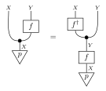
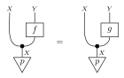

Conditioning and inference
==========================

Conditionalization
------------------

:meth:`~fxtensor_salmon.FXTensor.conditionalization` turns a joint state into
a kernel. ``concat_start_index`` is the 1-based index of the first codomain
factor that becomes the new codomain; the preceding factors become the
domain. A slice whose codomain sum is zero stays zero, and
:meth:`~fxtensor_salmon.FXTensor.is_markov` treats that row as allowed. The
receiver must be a state.

.. literalinclude:: ../../examples/inference.py
   :language: python
   :start-after: # docs:example conditionalization
   :end-before: # docs:end conditionalization

Conditional
-----------

:meth:`~fxtensor_salmon.FXTensor.conditional` is the same split for a kernel
``f: A → X ⊗ Y``. The domain of the result is ``A ⊗ X``. On a state it agrees
with ``conditionalization``.

.. literalinclude:: ../../examples/inference.py
   :language: python
   :start-after: # docs:example conditional
   :end-before: # docs:end conditional

Bayesian inversion
------------------

Given a prior state ``p: I → X`` and a kernel ``f: X → Y``,
:meth:`~fxtensor_salmon.FXTensor.bayesian_inversion` returns ``f†: Y → X``
with

.. code-block:: text

   f†(x|y) = p(x) f(y|x) / Σ_x' p(x') f(y|x')

Rows with zero evidence stay zero. ``X`` labels come from ``f`` when ``f`` is
labeled, otherwise from the prior. The finite equation
``p ; copy ; (id ⊗ f) = p ; f ; copy ; (f† ⊗ id)`` holds for the tensors this
method returns.

.. literalinclude:: ../../examples/inference.py
   :language: python
   :start-after: # docs:example bayes
   :end-before: # docs:end bayes

Support and almost-sure equality
---------------------------------

:meth:`~fxtensor_salmon.FXTensor.support` is a 0/1 tensor, same profile and
labels. Entries within ``FXTensor._ATOL`` of zero count as zero.

:meth:`~fxtensor_salmon.FXTensor.almost_surely_equal` asks whether two
tensors of the same profile agree wherever a prior state is positive. Labels
are not compared. The prior must be a state whose codomain matches the
domain.

:meth:`~fxtensor_salmon.FXTensor.is_absolutely_continuous` asks whether
``self`` is zero everywhere ``other`` is zero. For kernels this is checked
input by input. Profiles must match; labels are not compared.

.. literalinclude:: ../../examples/inference.py
   :language: python
   :start-after: # docs:example almost-sure
   :end-before: # docs:end almost-sure
