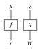

Quickstart
==========

A labeled kernel is a profile of string lists plus an array. ``profile``
reports the numeric shape. ``labels`` reports the strings. Label lookup uses
the NumPy axis: domain axes first, then codomain axes.

.. literalinclude:: ../examples/quickstart.py
   :language: python
   :start-after: # docs:example labeled-tensor
   :end-before: # docs:end labeled-tensor

The same array can be stored without labels. A tuple ``(domain, codomain)``
is also accepted and is always unlabeled.

.. literalinclude:: ../examples/quickstart.py
   :language: python
   :start-after: # docs:example unlabeled-tensor
   :end-before: # docs:end unlabeled-tensor

``from_strands`` fills entries from a dictionary. For a labeled profile the
keys are nested lists of those labels. Missing keys stay zero.

.. literalinclude:: ../examples/quickstart.py
   :language: python
   :start-after: # docs:example strands
   :end-before: # docs:end strands

Composition
-----------

``composition`` is sequential wiring. The codomain of the receiver must equal
the domain of the argument. Labels on the result are the receiver's domain
labels and the argument's codomain labels, and only when both tensors are
labeled.

.. literalinclude:: ../examples/quickstart.py
   :language: python
   :start-after: # docs:example composition
   :end-before: # docs:end composition

.. figure:: ../_static/figures/composition.svg
   :alt: Two morphisms composed in series, read from top to bottom
   :width: 140px
   :align: center

   Sequential composition, ``f ; g``.

Tensor product
--------------

``tensor_product`` places two morphisms side by side. For states, an empty
domain stays empty, so its label group is ``None``.

.. literalinclude:: ../examples/quickstart.py
   :language: python
   :start-after: # docs:example tensor-product
   :end-before: # docs:end tensor-product

   Tensor product, ``f ⊗ g``.

Weather
-------

Labels are arbitrary strings. The same forecast can be named in English or
Japanese; only the strings stored on the profile change.

.. literalinclude:: ../examples/quickstart.py
   :language: python
   :start-after: # docs:example weather-en
   :end-before: # docs:end weather-en

.. literalinclude:: ../examples/quickstart.py
   :language: python
   :start-after: # docs:example weather-ja
   :end-before: # docs:end weather-ja

The :doc:`user guide <guide/index>` covers conditioning, Bayesian inversion,
copy and discard, and the DisCoPy bridge.
