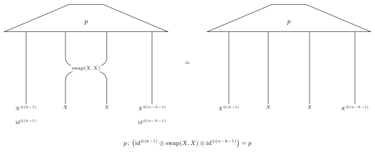
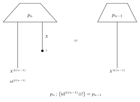

交換可能性
==========

状態 ``p: I → X^{⊗n}`` は、因子の置換で変わらないとき交換可能です。隣接互換は
対称群を生成するので、それを調べれば足ります。位置 ``k`` （1 始まり）で交換可能とは

``p ; (id^{⊗(k-1)} ⊗ swap(X, X) ⊗ id^{⊗(n-k-1)}) = p``

が成り立つことです。``k`` 番目と ``(k+1)`` 番目の紐を入れ替えても ``p`` は
変わりません。恒等の紐と入れ替える2本で、因子の数は
``(k-1) + 2 + (n-k-1) = n`` です。

   図は上から下に読む。左は
   ``p ; (id^{⊗(k-1)} ⊗ swap(X, X) ⊗ id^{⊗(n-k-1)})``、
   右は ``p``。交差は ``k`` 番目と ``(k+1)`` 番目の紐の入れ替え。

:meth:`~fxtensor_salmon.FXTensor.is_exchangeable` は ``k = 1 .. n-1`` を
調べ、``numpy.allclose`` で ``data`` を比べます。``swap`` はラベルを持たない
ので、ラベルは比較しません。``atol`` と ``rtol`` の既定値は ``FXTensor._ATOL``
と ``FXTensor._RTOL`` です。``n < 2`` は自明に真です。

``block`` は因子 ``X`` 一つの次元リストです。既定の ``None`` では codomain の
軸が1つずつ因子になり、軸のサイズはすべて同じでなければなりません。サイズの
違う軸が混ざると ``ValueError`` です。受け手は状態（空の domain）です。

対称化
------

:meth:`~fxtensor_salmon.FXTensor.symmetrize` は、``n`` 個の因子のあらゆる置換で
平均を取ります。プロファイルとラベルはそのままで、同じ ``block`` に対して
``is_exchangeable`` を満たします。もう一度平均しても変わらず、もともと交換可能な
状態も変わりません。``n > 8`` では ``n!`` 個の置換をたどるため警告します。

Kolmogorov 整合性
-----------------

列 ``p_n: I → X^{⊗n}`` が Kolmogorov 整合的であるとは、``n`` 番目の紐を破棄すると
一つ前の状態に戻ることです。

``p_n ; (id^{⊗(n-1)} ⊗ !) = p_{n-1}``

   図は上から下に読む。左は ``p_n ; (id^{⊗(n-1)} ⊗ !)``。黒丸は ``n`` 番目の
   紐の discard。右は ``p_{n-1}``。

:meth:`~fxtensor_salmon.FXTensor.is_kolmogorov_consistent` は
``[p_1, p_2, ..., p_N]`` を受け取ります。``states[0]`` が ``p_1`` です。
``!`` は ``X`` 上の :meth:`~fxtensor_salmon.FXTensor.exclamation` です。
長さ 0 または 1 の列には比べる組がありません。ただし要素が1つあるときは、
それが状態 ``I → X`` でなければなりません。``block`` は ``is_exchangeable``
と同じです。値は ``data`` で比べます。周辺が食い違う列は ``False`` です。
その位置の ``I → X^{⊗n}`` になっていない状態は ``ValueError`` です。

i.i.d. と混合
-------------

:meth:`~fxtensor_salmon.FXTensor.iid` は ``p`` を ``n`` 個テンソル積したものです。
ラベルは ``p`` から引き継ぎます。状態 ``I → X`` なら結果は ``I → X^{⊗n}`` です。

:meth:`~fxtensor_salmon.FXTensor.mixture_of_iid` は、状態 ``prior: I → Θ`` と
核 ``Θ → X`` から ``prior ; copy_Θ^{(n)} ; kernel^{⊗n}`` を作ります。事前分布から
1 回引き、それを複製して、核の独立な ``n`` 個のコピーに渡します。できた状態
``I → X^{⊗n}`` は交換可能で、``n`` を変えた列は Kolmogorov 整合的です。独立に
なるのは、事前分布が一点に集中しているときだけです。

コインのバイアスに事前分布を置くと、投げた結果の列は交換可能です。その事前分布が
Dirac でなければ、投げは独立ではありません。

.. literalinclude:: ../../examples/exchangeability.py
   :language: python
   :start-after: # docs:example coin
   :end-before: # docs:end coin

マルコフ圏での de Finetti の定理の有限形は、Fritz, Gonda, Perrone,
`De Finetti's theorem in categorical probability (arXiv:2105.02639)
<https://arxiv.org/abs/2105.02639>`_ にあります。単射に沿った交換可能性と、
挿入に沿った Kolmogorov 整合性は、Vaccarino,
`Statistical models as natural transformations (arXiv:2609.22929)
<https://arxiv.org/abs/2609.22929>`_ では統計モデルの整合性として現れます。
