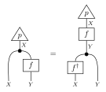
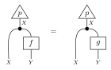

条件付けと推論
==============

条件付き化
----------

:meth:`~fxtensor_salmon.FXTensor.conditionalization` は同時状態を核にします。
``concat_start_index`` は、新しい codomain の先頭になる codomain 因子の
1 始まりの位置です。それより前の因子が domain になります。codomain の和が 0 の
スライスは 0 のままで、:meth:`~fxtensor_salmon.FXTensor.is_markov` はその行を
許容します。受け手は状態である必要があります。

.. literalinclude:: ../../examples/inference.py
   :language: python
   :start-after: # docs:example conditionalization
   :end-before: # docs:end conditionalization

核の条件付け
------------

:meth:`~fxtensor_salmon.FXTensor.conditional` は、核 ``f: A → X ⊗ Y`` に対する
同じ分割です。結果の domain は ``A ⊗ X`` です。状態に対しては
``conditionalization`` と一致します。

.. literalinclude:: ../../examples/inference.py
   :language: python
   :start-after: # docs:example conditional
   :end-before: # docs:end conditional

ベイズ反転
----------

事前状態 ``p: I → X`` と核 ``f: X → Y`` に対し、
:meth:`~fxtensor_salmon.FXTensor.bayesian_inversion` は次の ``f†: Y → X`` を
返します。

.. code-block:: text

   f†(x|y) = p(x) f(y|x) / Σ_x' p(x') f(y|x')

証拠が 0 の行は 0 のままです。``X`` のラベルは、``f`` がラベル付きなら ``f`` から、
そうでなければ事前状態から取ります。このメソッドが返すテンソルでは、有限の等式
``p ; copy ; (id ⊗ f) = p ; f ; copy ; (f† ⊗ id)`` が成り立ちます。

   ベイズ反転: ``p ; copy ; (id ⊗ f) = p ; f ; copy ; (f† ⊗ id)``。

.. literalinclude:: ../../examples/inference.py
   :language: python
   :start-after: # docs:example bayes
   :end-before: # docs:end bayes

台とほとんど確実な等価
----------------------

:meth:`~fxtensor_salmon.FXTensor.support` は、同じプロファイルとラベルを持つ
0/1 テンソルです。``FXTensor._ATOL`` 以内の成分は 0 とみなします。

:meth:`~fxtensor_salmon.FXTensor.almost_surely_equal` は、事前状態が正である
点で、同じプロファイルの2つのテンソルが一致するかを見ます。ラベルは比べません。
事前状態は、codomain が domain と一致する状態である必要があります。

:meth:`~fxtensor_salmon.FXTensor.is_absolutely_continuous` は、``other`` が 0 の
場所で ``self`` も 0 かを見ます。核では入力ごとに確認します。プロファイルは
一致している必要があり、ラベルは比べません。

   ほとんど確実な等価: ``p ; copy ; (id ⊗ f) = p ; copy ; (id ⊗ g)``。

.. literalinclude:: ../../examples/inference.py
   :language: python
   :start-after: # docs:example almost-sure
   :end-before: # docs:end almost-sure
