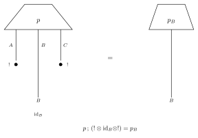
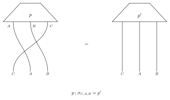

名前付きの軸
============

値のラベルは、軸の上の点の名前です。たとえば ``low`` と ``high`` です。
軸の名前は、紐そのものの名前です。たとえば ``A`` や ``C`` です。同じラベルが
いくつかの紐に付いていても、名前で区別できます。``names`` を省略したテンソルは、
これまでどおり動きます。

名前は ``(domain の名前, codomain の名前)`` で渡します。1 つのテンソルの中では
一意です。名前がないとき :attr:`~fxtensor_salmon.FXTensor.names` は
``(None, None)`` です。:meth:`~fxtensor_salmon.FXTensor.rename` は名前を
付け替え、:meth:`~fxtensor_salmon.FXTensor.axis` は軸番号を返します。
domain の軸を先に数えるのは :meth:`~fxtensor_salmon.FXTensor.get_label_index`
と同じです。

周辺化
------

:meth:`~fxtensor_salmon.FXTensor.marginal` は、指定した codomain の紐だけを、
指定した順に残し、残りを和で落とします。真ん中の紐も落とせます。
:meth:`~fxtensor_salmon.FXTensor.marginalize` は、落とす紐を ``drop`` で
指定します。残った紐の順序は元のままです。

状態 ``p: I → A ⊗ B ⊗ C`` で ``B`` だけを残すことは、``A`` と ``C`` を破棄する
決定的な配線です。

``p ; (! ⊗ id_B ⊗ !) = p_B``

   図は上から下に読む。左は ``p ; (! ⊗ id_B ⊗ !)``。黒丸は discard。
   右は ``B`` の周辺状態。

ラベルは残した紐といっしょに動きます。domain は変わりません。

並べ替え
--------

:meth:`~fxtensor_salmon.FXTensor.permute` は、codomain を与えた名前の順に
並べ替えます。domain はそのままで、ラベルは紐といっしょに動きます。状態では
すべての軸を並べ替えることになります。この並べ替えは紐の置換で、図では交差です。

   図は上から下に読む。左は ``p`` の紐 ``A``、``B``、``C`` を
   ``C``、``A``、``B`` の順へ交差させたもの。右は並べ替えた状態。

観測
----

:meth:`~fxtensor_salmon.FXTensor.observe` は、状態を ``名前=ラベル`` の観測で
条件付けます。ラベルがない軸では、値は整数の添字です。観測した紐を
:meth:`~fxtensor_salmon.FXTensor.permute` で先頭へ移し、
:meth:`~fxtensor_salmon.FXTensor.conditionalization` の行を読みます。
戻り値は、残った紐の事後の同時状態 （元の相対順） と、証拠の確率です。
複数の観測を一度に渡すと、1 つずつ観測したときと同じ事後になり、確率は
それらの同時確率です。証拠が 0 のときは ``ValueError`` です。

連鎖 ``A → C → D`` では、``observe(C="high")`` のあと ``A`` を周辺化した分布が、
その ``C`` の値に対する :meth:`~fxtensor_salmon.FXTensor.bayesian_inversion`
の行と一致します。

.. literalinclude:: ../../examples/names.py
   :language: python
   :start-after: # docs:example chain
   :end-before: # docs:end chain

名前の伝播
----------

:meth:`~fxtensor_salmon.FXTensor.composition` は、``self`` の codomain の名前と
``other`` の domain の名前が両方あるとき、それらが一致するかを調べます。
結果は ``self`` の domain の名前と ``other`` の codomain の名前を持ちます。
:meth:`~fxtensor_salmon.FXTensor.tensor_product` は名前を連結し、重複すると
``ValueError`` です。片方に軸があって名前がないときは、積の名前はありません。
:meth:`~fxtensor_salmon.FXTensor.bayesian_inversion` は domain と codomain の
名前を入れ替えます。:meth:`~fxtensor_salmon.FXTensor.conditional` と
:meth:`~fxtensor_salmon.FXTensor.conditionalization` は、軸と同じ位置で
名前を分けます。

:meth:`~fxtensor_salmon.FXTensor.to_json` は、名前を ``names`` に
``[domain の名前, codomain の名前]`` として保存します。``names`` のない JSON は、
名前のないテンソルとして読みます。
