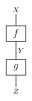
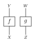

操作
====

codomain を分割する添字（``start_B`` と ``concat_start_index``）は、codomain
因子に沿った **1 始まり** の位置です。

合成とテンソル積
----------------

:meth:`~fxtensor_salmon.FXTensor.composition` は ``numpy.tensordot`` で、受け手の
codomain と引数の domain を縮約します。プロファイルが一致しないと ``ValueError``
です。ラベルが残るのは、両方がラベル付きのときだけです。

:meth:`~fxtensor_salmon.FXTensor.tensor_product` は domain と codomain を連結し、
ブロードキャストした配列を掛けます。片方がラベルなしで、かつ軸を1本以上持つと、
ラベルは落ちます。軸を持たないラベルなしスカラーは、相手のラベルを消しません。

.. literalinclude:: ../../examples/operations.py
   :language: python
   :start-after: # docs:example product-labels
   :end-before: # docs:end product-labels

周辺化
------

:meth:`~fxtensor_salmon.FXTensor.marginalization` は、``start_B`` から末尾までの
codomain 軸を和で落とし、残った接頭のラベルを保ちます。``start_B`` が
``len(codomain) + 1`` のときは何も和をとらず、同じオブジェクトを返します。
``start_B == 1`` は codomain 全体の和です。有効な範囲は ``1`` から
``len(codomain) + 1`` までです。

.. literalinclude:: ../../examples/operations.py
   :language: python
   :start-after: # docs:example marginal
   :end-before: # docs:end marginal

:meth:`~fxtensor_salmon.FXTensor.discard_prefix` は ``start_B`` より前の
codomain 軸を和で落とし、接尾とそのラベルを残します。``start_B == 1`` は同じ
オブジェクトを返します。

.. literalinclude:: ../../examples/operations.py
   :language: python
   :start-after: # docs:example discard-prefix
   :end-before: # docs:end discard-prefix

:meth:`~fxtensor_salmon.FXTensor.first_marginalization` と
:meth:`~fxtensor_salmon.FXTensor.second_marginalization` は、恒等と
:meth:`~fxtensor_salmon.FXTensor.exclamation` の合成で同じ分割を行います。
これらのコンストラクタは数値なので、結果はラベルなしです。``first`` は
``concat_start_index`` から始まる接尾を落とし、``second`` はその前の接頭を
落とします。

.. literalinclude:: ../../examples/operations.py
   :language: python
   :start-after: # docs:example diagram-marginals
   :end-before: # docs:end diagram-marginals

部分合成
--------

``f: A → B ⊗ C`` と ``g: C → D`` に対し、``f.partial_composition(g, k)`` は
1 始まりの添字 ``k`` より前の codomain を残し、接尾を ``g`` に渡します。
``k == 1`` は codomain 全体を渡すので、値は
:meth:`~fxtensor_salmon.FXTensor.composition` と一致します。実装は残す接頭に
数値の恒等を作るため、結果のラベルは消えます。

.. literalinclude:: ../../examples/operations.py
   :language: python
   :start-after: # docs:example partial
   :end-before: # docs:end partial

同時化
------

:meth:`~fxtensor_salmon.FXTensor.jointification` は2つの状態のテンソル積です。
domain は両方とも空である必要があります。ラベルが残るのは両方がラベル付きの
ときだけで、状態の domain 側ラベルは ``None`` です。

.. literalinclude:: ../../examples/operations.py
   :language: python
   :start-after: # docs:example joint
   :end-before: # docs:end joint
