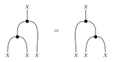
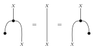
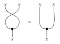
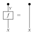

構造射
======

これらのコンストラクタは、マルコフ圏の決定的な配線を作ります。
``copy_tensor``、``identity_tensor``、``delta_tensor`` は、整数の長さか
文字列ラベルのリストを受けます。``swap``、``exclamation``、``unit_tensor`` は
整数の長さだけを受けます。

恒等、デルタ、複製
------------------

:meth:`~fxtensor_salmon.FXTensor.identity_tensor` は恒等核です。
:meth:`~fxtensor_salmon.FXTensor.delta_tensor` はその別名です。
:meth:`~fxtensor_salmon.FXTensor.copy_tensor` は対角 ``X → X⊗n`` です。
``n=1`` は恒等、``n=0`` は破棄（domain 上のすべて 1）、負の ``n`` は
``ValueError`` です。因子リストが空なら、モノイド単位上のスカラー ``1`` です。

.. literalinclude:: ../../examples/structural.py
   :language: python
   :start-after: # docs:example identity-copy
   :end-before: # docs:end identity-copy

交換、破棄、すべて 1 の状態
---------------------------

:meth:`~fxtensor_salmon.FXTensor.swap` は2つの因子ブロックを入れ替えます。
:meth:`~fxtensor_salmon.FXTensor.exclamation` は破棄 ``X → I`` で、domain 上は
すべて 1、codomain は空です。
:meth:`~fxtensor_salmon.FXTensor.unit_tensor` はすべて 1 の状態です。正規化は
されておらず、モノイド単位（空のプロファイル）でもありません。

.. literalinclude:: ../../examples/structural.py
   :language: python
   :start-after: # docs:example swap-discard
   :end-before: # docs:end swap-discard

copy の法則
-----------

これらのテンソルの上で、copy は余可換・余結合・余単位的で、discard は自然です。
つまり核 ``f`` に対して ``f ; ! = !`` です。決定的な核は copy と交換します。

.. literalinclude:: ../../examples/structural.py
   :language: python
   :start-after: # docs:example copy-laws
   :end-before: # docs:end copy-laws
